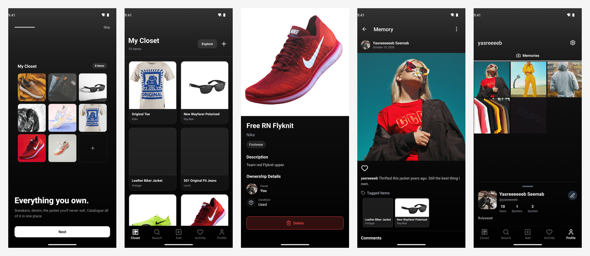

# Spotlight

**A social closet app for the clothes you love.** Catalogue everything you own (sneakers, denim,
the jacket you'll never sell), post memories of the moments you wore them, and follow friends and
brands to see what they own.



<sub>Real screens from the Android app, captured automatically in CI with Maestro on an emulator.</sub>

## Features

- **Closet:** add items you own from a product catalogue or create a community product with
  photos (compressed on device before upload); browse your closet and explore other people's.
- **Ownership:** every item in a closet is an ownership record (owner, condition, description),
  so the same catalogue product can be owned by many people.
- **Memories:** photo posts that tag the items in them, with likes and comments.
- **Social graph:** follow people (with follow requests for private profiles) and follow brands;
  brand pages list their products and followers.
- **Search and activity:** search across people, brands and products; an activity tab to accept
  or reject follow requests.
- **Accounts:** email sign-up with verification, password reset, deep links back into the app
  (universal links through a small companion web app), and full account deletion.

## How it's built

| Layer | What |
|---|---|
| App | Expo (React Native, new architecture), Expo Router file-based navigation, TypeScript |
| UI | NativeWind (Tailwind for React Native), Reanimated, light and dark mode |
| State and data | TanStack Query for server state, Redux Toolkit for session state, MMKV for fast local storage |
| Backend | Supabase: Postgres with row-level security, Auth, Storage, and 6 Deno edge functions |
| Schema | 18 Prisma models (users, followers, brands, products, ownerships, memories, likes, comments, …) |
| CI | GitHub Actions: an Android emulator run with Maestro that logs in and captures the screens above; a scheduled job that keeps the Supabase project awake |

The code is organised by feature (`src/features/auth`, `closet`, `memories`, `ownerships`,
`brands`, `search`, `notifications`, …), each with its own screens, hooks and services.
Work that must not trust the client (creating a user profile on sign-up, creating ownerships and
community products, cleaning up after account deletion) runs in edge functions with the
service-role key, which never ships in the app.

## Run it

Needs [Bun](https://bun.sh) and an Android emulator or device (or Xcode for iOS).

```bash
bun install
bun run start            # Expo dev server, points at the hosted Supabase project
bun run android          # build and install the dev client on Android
```

To use your own Supabase project, set `EXPO_PUBLIC_SUPABASE_URL` and
`EXPO_PUBLIC_SUPABASE_ANON_KEY`, apply `supabase/migrations`, and deploy the functions in
`supabase/functions` with the Supabase CLI.

## Credits

Started from the [fast-expo-app](https://github.com/Teczer/fast-expo-app) boilerplate by Hattou
Mehdi (MIT). Everything beyond the starter (the app, data model, edge functions and CI) is mine.
